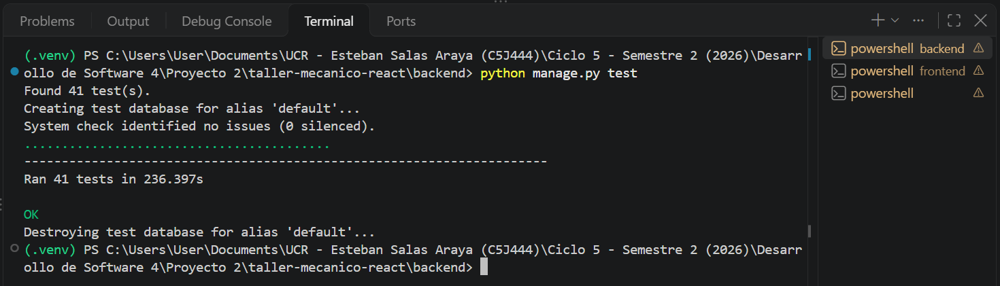
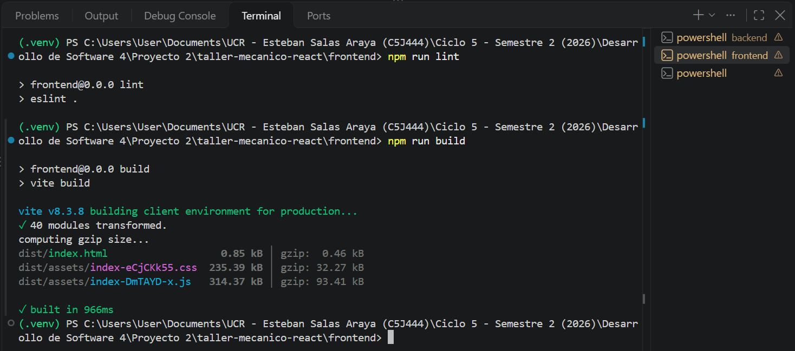
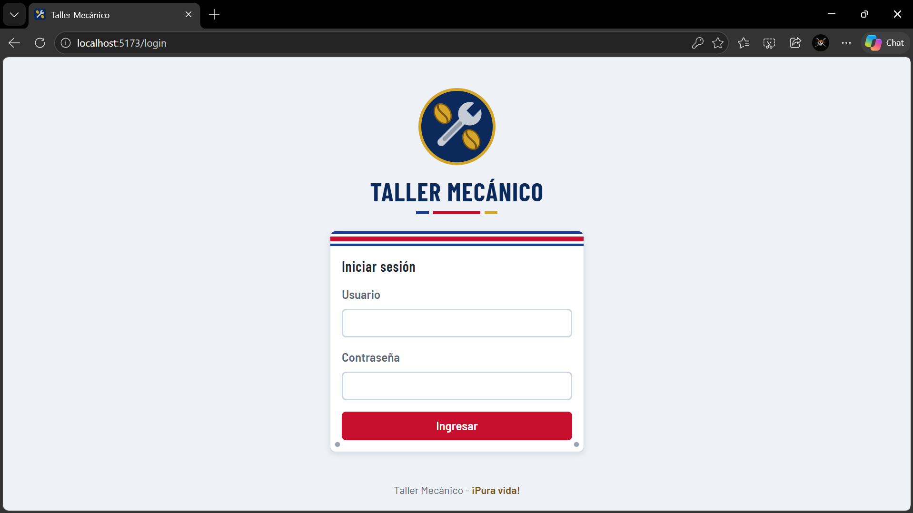
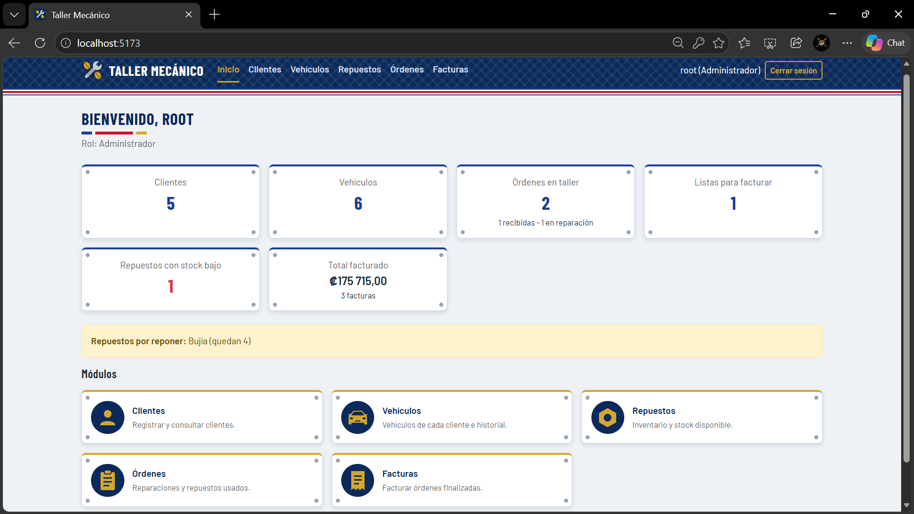
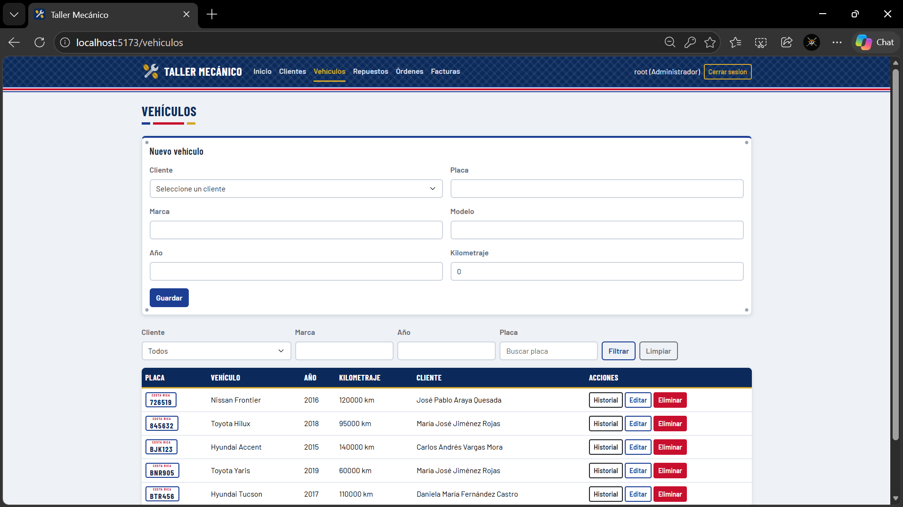
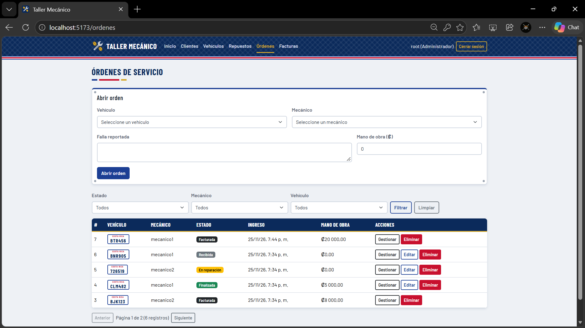
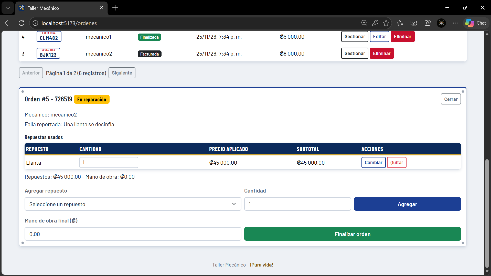
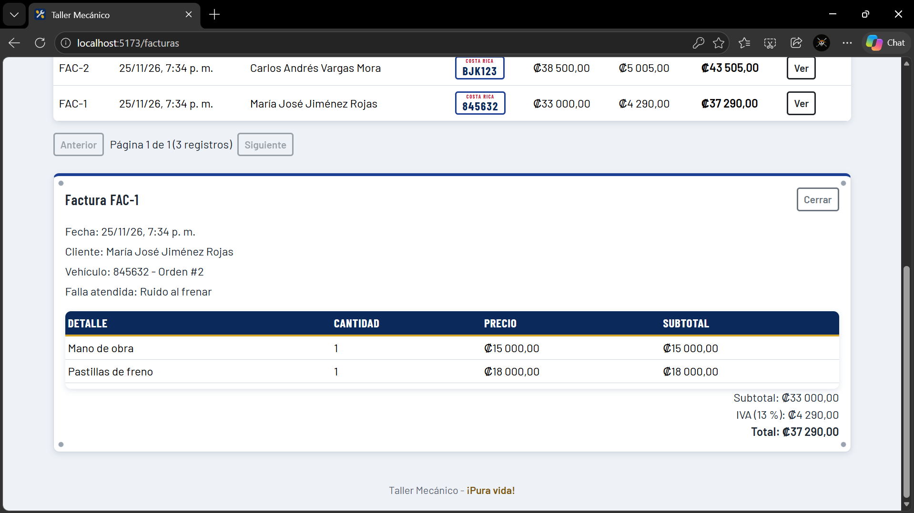

# Taller Mecánico

**Proyecto Programado #2 - Desarrollo de Software IV (IF-0009)**
Bachillerato en Informática Empresarial
Universidad de Costa Rica (UCR), Sede Regional del Pacífico
II Semestre 2026

**Integrantes**

| Nombre | Carné |
|---|---|
| Esteban Salas Araya | C5J444 |
| Aletia Ledezma Araya | C4G420 |
| Yendri Jiménez Molina | C4G264 |

---

## Descripción

Aplicación web de una sola página (SPA) en **React** para administrar un taller mecánico. Consume la API REST del Proyecto 1 (Django REST Framework + MySQL) y permite gestionar clientes, vehículos, repuestos, órdenes de servicio y facturas, con inicio de sesión por token y permisos según el rol del usuario.

El diseño usa los colores de Costa Rica (azul, blanco y rojo) con detalles en dorado por el grano de oro (café), y detalles de taller mecánico.

**Tecnologías**

- **Frontend:** React 19, Vite, React Router, Bootstrap 5 y `fetch`.
- **Backend:** Python, Django 5.2, Django REST Framework, MySQL y `django-cors-headers`.

**Repositorio del Proyecto 1 (API):** https://github.com/salas-araya-444/taller-mecanico-api

La documentación del frontend (pantallas y endpoints, matriz de permisos, flujo de una orden y cosas nuevas que se usaron) está en [`docs/DOCUMENTACION_FRONTEND.md`](docs/DOCUMENTACION_FRONTEND.md).
La documentación técnica del backend está en [`backend/docs/DOCUMENTACION_TECNICA.md`](backend/docs/DOCUMENTACION_TECNICA.md).

---

## Estructura del proyecto

```
taller-mecanico-react/
├── backend/                API REST (Django) copiada del Proyecto 1, con CORS, logout y lista de mecánicos
├── frontend/
│   ├── public/             Ícono de la pestaña
│   └── src/
│       ├── components/     Menú, logo, íconos, alertas, paginación, ruta protegida y panel de la orden
│       ├── pages/          Login, Inicio, Clientes, Vehículos, Repuestos, Órdenes y Facturas
│       ├── services/       api.js (llamadas a la API y sesión) y formato.js (montos, fechas y estados)
│       ├── App.jsx         Rutas de la aplicación
│       └── index.css       Diseño visual
└── docs/
    ├── DOCUMENTACION_FRONTEND.md
    └── capturas/           Capturas de pantalla de la aplicación
```

---

## Requisitos

- Python 3.12 o superior
- Node.js 20 o superior (incluye `npm`)
- MySQL Server 8 y MySQL Workbench
- Git

---

## Instalación y ejecución

Se usan **dos terminales**: una para el backend y otra para el frontend.

### 1. Clonar el repositorio

```bash
git clone https://github.com/salas-araya-444/taller-mecanico-react.git
cd taller-mecanico-react
```

### 2. Backend (terminal 1)

```bash
cd backend
python -m venv .venv
.venv\Scripts\activate
pip install -r requirements.txt
```

En Linux o macOS el entorno se activa con `source .venv/bin/activate`.

**Base de datos y `.env`:**

1. En MySQL Workbench ejecute el script `backend/database/taller_mecanico_db.sql` (crea la base `taller_mecanico_db` y el usuario `taller_user`). Antes de ejecutarlo, cambie `CAMBIAR_POR_CONTRASENA_LOCAL` por una contraseña.
2. Copie `backend/.env.example` como `backend/.env` y complete los datos de su MySQL (`DB_PASSWORD` con la contraseña del paso anterior y `DB_PORT` con su puerto, normalmente `3306`).

Luego:

```bash
python manage.py migrate
python manage.py cargar_datos
python manage.py runserver
```

La API queda en `http://127.0.0.1:8000/api/`.

### 3. Frontend (terminal 2)

```bash
cd frontend
npm install
```

Copie `frontend/.env.example` como `frontend/.env` (no hay que cambiarle nada):

```
VITE_API_URL=http://127.0.0.1:8000/api
```

Luego:

```bash
npm run dev
```

Abra **http://localhost:5173** en el navegador.

---

## Configuración de CORS

React (puerto 5173) y Django (puerto 8000) corren en direcciones distintas, y el navegador bloquea esas llamadas si la API no las autoriza. Por eso el backend usa `django-cors-headers`, configurado en `backend/taller_backend/settings.py`:

```python
INSTALLED_APPS = [..., 'corsheaders', ...]

MIDDLEWARE = [
    'corsheaders.middleware.CorsMiddleware',   # va de primero
    ...
]

CORS_ALLOWED_ORIGINS = [
    'http://localhost:5173',
    'http://127.0.0.1:5173',
]
```

Solo se permiten esas dos direcciones (las del servidor de desarrollo de Vite), no todo el internet. Si el frontend se publica en otra dirección, hay que agregarla a `CORS_ALLOWED_ORIGINS`.

---

## Usuarios de prueba

El comando `python manage.py cargar_datos` crea los roles, estos usuarios y algunos datos de ejemplo (3 clientes, 4 vehículos y 5 repuestos):

| Usuario | Rol | Contraseña |
|---|---|---|
| `admin_taller` | Administrador | `Taller2026*` |
| `recepcion` | Recepcionista | `Taller2026*` |
| `mecanico1` | Mecánico | `Taller2026*` |
| `mecanico2` | Mecánico | `Taller2026*` |

Son contraseñas solo para pruebas.

---

## Prueba guiada (flujo completo)

Con estos datos se puede probar todo el recorrido de un carro en el taller, desde que llega hasta que se factura. Entre con `admin_taller`.

| Paso | Pantalla | Qué hacer | Datos de ejemplo |
|---|---|---|---|
| 1 | Clientes | Llenar el formulario y **Guardar** | Nombre: Daniela María Fernández Castro - Cédula: 115670234 - Teléfono: 83127456 - Correo: daniela.fernandez@gmail.com |
| 2 | Vehículos | Elegir el cliente y **Guardar** | Placa: BTR456 - Hyundai Tucson - Año: 2017 - Kilometraje: 110000 |
| 3 | Repuestos | Llenar el formulario y **Guardar** | Código: R007 - Amortiguador - Precio: 32000 - Stock: 6 - Stock mínimo: 2 |
| 4 | Órdenes | **Abrir orden** | Vehículo: BTR456 - Mecánico: mecanico1 - Falla: Golpeteo en la suspensión delantera |
| 5 | Órdenes → Gestionar | **Iniciar reparación** | La orden pasa a *En reparación* |
| 6 | Órdenes → Gestionar | **Agregar** repuesto | Amortiguador, cantidad 2 (el stock baja de 6 a 4) |
| 7 | Órdenes → Gestionar | **Finalizar orden** | Mano de obra final: 20000 |
| 8 | Facturas | Elegir la orden y **Facturar** | Subtotal ₡84 000 - IVA (13 %) ₡10 920 - **Total ₡94 920** |

**Para probar los permisos:**

- Entre con `recepcion`: puede trabajar clientes, vehículos, órdenes y facturas, pero los repuestos solo los consulta.
- Entre con `mecanico1`: no tiene el menú de Facturas; si escribe `http://localhost:5173/facturas`, la API responde **403** y se muestra el aviso.
- Una orden facturada ya no se puede modificar ni eliminar; si se intenta, la API responde con el mensaje correspondiente.

---

## Pruebas

**Backend (pruebas automatizadas de Django):** en la carpeta `backend`, con el entorno virtual activado:

```bash
python manage.py test
```

Resultado: **41 pruebas en OK**. Cubren modelos, reglas del negocio, permisos por rol, stock, estados de la orden, facturación y validación de filtros.



**Frontend:** en la carpeta `frontend`:

```bash
npm run lint     # revisa el código sin errores
npm run build    # genera la versión final sin errores
```



---

## Pantallas

| Inicio de sesión | Inicio (Administrador) |
|---|---|
|  |  |

| Vehículos | Órdenes |
|---|---|
|  |  |

| Panel de la orden | Detalle de factura |
|---|---|
|  |  |

Todas las capturas están en [`docs/capturas/`](docs/capturas/) y se describen en la documentación del frontend.

---

## Limitaciones

- **El token no vence.** Django REST Framework usa un token fijo por usuario. Al cerrar sesión la API lo borra (`POST /api/logout/`) y deja de servir, pero si no se cierra sesión sigue siendo válido.
- **El token se guarda en `localStorage`.** Es lo más sencillo para mantener la sesión al recargar, pero queda expuesto si la página sufriera un ataque XSS. Una versión de producción usaría cookies `HttpOnly`.
- **No hay pantalla para administrar usuarios ni recuperar la contraseña.** Los usuarios se crean con `cargar_datos` o desde el administrador de Django.
- **Las facturas no se pueden anular.** Una vez creadas no se editan ni se eliminan; una anulación o nota de crédito quedó fuera del alcance.
- **El frontend solo tiene revisión con `npm run lint` y `npm run build`.** Las pruebas automatizadas (41) son del backend; las del frontend se hicieron manualmente (escenarios de la documentación).
- **Solo funciona de forma local.** No está desplegado en un servidor, y CORS solo permite las direcciones de desarrollo de Vite.

---

## Organización del trabajo

El trabajo se dividió en Pull Requests. Cada integrante subió sus cambios desde su rama personal (`esteban`, `aletia`, `yendri`) hacia `main`, y otro integrante revisó y aprobó antes del merge.

| PR | Integrante | Contenido |
|---|---|---|
| 1 | Esteban | Estructura del frontend (React + Vite) |
| 2 | Esteban | Ajustes del backend (CORS, logout, mecánicos) y login, logout y menú |
| 3 | Esteban | Clientes y vehículos |
| 4 | Aletia | Repuestos |
| 5 | Aletia | Órdenes de servicio y panel de la orden |
| 6 | Yendri | Inicio con indicadores |
| 7 | Yendri | Facturación |
| 8 | Esteban | Diseño visual final |
| 9 | Esteban | Ajuste visual en el inicio de sesión |
| 10 | Yendri | README y documentación |
| 11 | Aletia | Capturas de pantalla |
| 12 | Esteban | Nombre del taller en el login y el menú |
| 13 | Esteban | Correcciones del backend y evidencia de pruebas |
